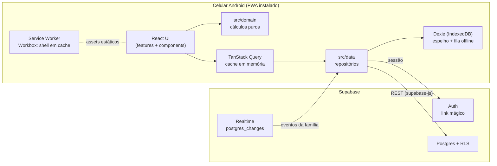

# 04 — Arquitetura

## 1. Visão geral



- A interface lê sempre do **TanStack Query**, que é alimentado pelos **repositórios** (`src/data`).
- Os repositórios leem do Supabase quando online e gravam cada resultado no **Dexie**; offline, servem o que está no Dexie.
- Escritas de lançamentos passam pela **fila** no Dexie e são enviadas ao Supabase (imediatamente se online).
- O **Realtime** do Supabase avisa mudanças da família; o repositório aplica a mudança no Dexie e invalida as queries afetadas.
- O **service worker** cuida apenas do shell do app (HTML, JS, CSS, fontes, ícones). Ele **não** faz cache das chamadas ao Supabase — os dados offline são responsabilidade do Dexie.

## 2. Decisões de arquitetura (ADR resumido)

| # | Decisão | Motivo | Alternativa descartada |
|---|---|---|---|
| ADR-01 | **Supabase** como backend (Auth + Postgres + RLS + Realtime) | Conta compartilhada exige servidor; RLS resolve o isolamento por família sem escrever API; plano gratuito atende uma família com folga; Realtime nativo | Firebase (modelo NoSQL dificulta as consultas por mês e as regras com vigência); API própria (mais código e operação) |
| ADR-02 | **Cálculos no cliente**, em `src/domain` | Todos os números dependem de "hoje" no fuso do usuário e de dados já carregados; permite funcionar offline; fácil de testar | Views/funções SQL de agregação (duplicaria regras e não funcionaria offline) |
| ADR-03 | **Centavos inteiros** | Evita erro de ponto flutuante | `numeric` + `float` no cliente |
| ADR-04 | **Regras de baldinho com vigência mensal** | Mudar um limite não pode reescrever o planejado de meses passados (governança) | Limite único por baldinho (comportamento do protótipo) |
| ADR-05 | **Exclusão lógica de lançamentos** (`excluido_em`) | Sincronização offline e tempo real precisam propagar exclusões | `DELETE` físico |
| ADR-06 | **ID gerado no cliente** + `upsert` | Envio idempotente da fila offline (reenvio não duplica) | ID serial do banco |
| ADR-07 | **Dexie** para dados offline, SW só para o shell | Controle explícito de leitura, fila e conflitos; Workbox não sabe resolver conflito de escrita | `NetworkFirst` do Workbox sobre a API REST |
| ADR-08 | **CSS Modules + tokens CSS**, sem biblioteca de UI | App pequeno, identidade própria do protótipo, bundle leve | MUI/Tailwind |
| ADR-09 | **Gráfico em SVG próprio** | Um único gráfico simples; bibliotecas pesam 40–100 KB | Recharts/Chart.js |
| ADR-10 | **Link mágico** como único login no MVP | Sem senha para lembrar; dois usuários | Senha; Google OAuth (pode entrar depois) |

## 3. Estrutura de pastas

```
baldinhos/
├── CLAUDE.md
├── docs/                       # esta documentação
├── reference/prototipo.html    # protótipo aprovado
├── public/
│   ├── icons/                  # icon-192.png, icon-512.png, maskable-512.png, shortcut-lancar-96.png
│   └── robots.txt
├── supabase/
│   ├── config.toml
│   ├── migrations/             # 0001_init.sql, 0002_rls.sql, 0003_funcoes.sql …
│   └── seed.sql                # apenas para ambiente local (família de teste)
├── src/
│   ├── main.tsx                # bootstrap, registro do SW
│   ├── app/
│   │   ├── App.tsx             # providers + rotas
│   │   ├── routes.tsx
│   │   └── providers/          # QueryProvider, AuthProvider, FamiliaProvider, MesProvider, HojeProvider
│   ├── domain/                 # SEM React, SEM Supabase
│   │   ├── dinheiro.ts         # parse/format de centavos
│   │   ├── datas.ts            # hoje SP, dias do mês, dia da semana, semana seg–dom
│   │   ├── regras.ts           # regra vigente, planejado, previsto (RN-10..31)
│   │   ├── status.ts           # desvio, saldo, status (RN-50..53)
│   │   ├── periodo.ts          # período atual (RN-60..63)
│   │   ├── visaoMes.ts         # monta o modelo da tela do mês a partir dos dados
│   │   ├── ritmo.ts            # séries do gráfico (RN-80..84)
│   │   ├── tipos.ts            # Familia, Membro, Baldinho, Regra, Lancamento, Mes …
│   │   └── __tests__/
│   ├── data/
│   │   ├── supabase.ts         # createClient com env
│   │   ├── database.types.ts   # gerado pelo supabase gen types
│   │   ├── db-local.ts         # Dexie: tabelas espelho + fila
│   │   ├── repos/              # familiaRepo, baldinhosRepo, lancamentosRepo
│   │   ├── realtime.ts         # canal por família
│   │   ├── sync.ts             # processamento da fila, reconexão
│   │   └── hooks/              # useBaldinhos, useLancamentosMes, useSalvarLancamento …
│   ├── features/
│   │   ├── auth/               # LoginScreen, ConviteScreen, OnboardingFamilia
│   │   ├── mes/                # MesScreen, ResumoCard, RitmoCard, ListaBaldinhos, DetalheBaldinhoSheet
│   │   ├── lancamentos/        # LancamentosScreen, LancamentoSheet
│   │   ├── baldinhos/          # BaldinhosScreen, BaldinhoSheet, SugestoesSheet, Reordenar
│   │   └── familia/            # FamiliaScreen, Convites, Membros
│   ├── components/             # TopBar, MonthSwitcher, BottomNav, Fab, Sheet, BucketIcon,
│   │                           # ProgressBar, StatusChip, AmountInput, Segmented, ColorSwatches,
│   │                           # Toast, SyncIndicator, UpdateBanner, InstallCard, EmptyState
│   ├── styles/
│   │   ├── tokens.css          # cores, fontes, raios, espaçamentos (docs/06 §2)
│   │   └── global.css
│   └── pwa/
│       ├── registerSW.ts       # useRegisterSW do vite-plugin-pwa + UpdateBanner
│       └── install.ts          # beforeinstallprompt
├── tests/e2e/                  # Playwright
├── index.html
├── vite.config.ts
├── tsconfig.json
└── .env.example
```

**Nomes:** entidades de domínio em português, como no glossário (`Baldinho`, `Lancamento`, `Regra`, `Familia`, `Membro`), tanto nos tipos TypeScript quanto nas tabelas. Todo o restante (componentes de UI genéricos, hooks utilitários, variáveis técnicas) em inglês. Sem acentos em identificadores.

## 4. Camada de domínio (`src/domain`)

Assinaturas de referência (ajustar nomes se necessário, mantendo a separação):

```ts
// tipos.ts
export type Centavos = number;                       // inteiro
export type DataCivil = `${number}-${number}-${number}`; // 'YYYY-MM-DD'
export type MesRef = { ano: number; mes: number };    // mes 1..12
export type Periodicidade = 'dia' | 'semana' | 'mes';
export type DiasQueContam = 'uteis' | 'fds' | 'todos';

export interface Regra {
  id: string; baldinhoId: string;
  vigenteDesde: DataCivil;          // sempre dia 01
  periodicidade: Periodicidade; dias: DiasQueContam; valorCentavos: Centavos;
}
export interface Baldinho {
  id: string; familiaId: string; nome: string; cor: string; ordem: number;
  arquivadoDesde: DataCivil | null; regras: Regra[];
}
export interface Lancamento {
  id: string; familiaId: string; baldinhoId: string; valorCentavos: Centavos;
  data: DataCivil; descricao: string;
  criadoPor: string; criadoEm: string; atualizadoPor: string | null; atualizadoEm: string;
  excluidoEm: string | null;
  pendente?: boolean;               // só no cliente: ainda na fila offline
}

// datas.ts
export function hojeSP(agora?: Date): DataCivil;
export function diasNoMes(m: MesRef): number;
export function diaDaSemana(d: DataCivil): 0|1|2|3|4|5|6;
export function semanaDe(d: DataCivil): { inicio: DataCivil; fim: DataCivil };
export function diaDeReferencia(m: MesRef, hoje: DataCivil): number;   // RN-30
export function intervaloDeCarga(m: MesRef, hoje: DataCivil): { de: DataCivil; ate: DataCivil }; // RN-63

// regras.ts
export function regraVigente(b: Baldinho, m: MesRef): Regra | null;   // RN-10
export function planejadoMes(r: Regra | null, m: MesRef): Centavos;   // RN-20..22
export function previstoAte(r: Regra | null, m: MesRef, t: number): Centavos; // RN-31

// status.ts
export type Tom = 'neutro' | 'positivo' | 'atencao' | 'critico';
export function statusDe(i: { R: Centavos; P: Centavos; Pt: Centavos; tipoMes: 'passado'|'atual'|'futuro' }):
  { tom: Tom; texto: string };                                      // RN-52

// visaoMes.ts
export function montarVisaoMes(i: { mes: MesRef; hoje: DataCivil; baldinhos: Baldinho[]; lancamentos: Lancamento[] }): VisaoMes;
```

`VisaoMes` contém: totais (R, P, Pt, desvio, saldo, status), linhas por baldinho (com status, frações da barra, período atual) e as séries do gráfico. A tela do mês, o detalhe do baldinho e a aba Baldinhos consomem apenas esse modelo.

## 5. Fluxo de dados

### Leitura do mês
1. `MesProvider` define o mês em exibição.
2. `useLancamentosMes(familiaId, mes)` calcula `intervaloDeCarga` (RN-63) e busca `lancamentos` com `data between de and ate` e `excluido_em is null`.
3. `useBaldinhos(familiaId)` busca baldinhos com todas as regras (são poucos; carregar tudo).
4. `montarVisaoMes` gera o modelo; componentes renderizam.

### Escrita de lançamento
1. Formulário chama `useSalvarLancamento` com o objeto completo (id gerado no cliente).
2. O hook aplica atualização otimista no cache do TanStack Query e grava no Dexie (`lancamentos` + `fila`).
3. `sync.ts` envia a fila: `upsert` em `lancamentos` com `onConflict: 'id'`.
4. Sucesso remove da fila e marca `pendente = false`; erro de rede mantém na fila; erro de validação (4xx) remove da fila, desfaz a mudança local e mostra aviso.

### Tempo real
- Um canal por família: `supabase.channel('familia:{id}')` com `postgres_changes` em `lancamentos`, `baldinhos` e `regras_baldinho` filtrados por `familia_id=eq.{id}`.
- Ao receber evento: aplicar no Dexie e invalidar a query correspondente (lançamentos do mês afetado pela `data`; baldinhos).
- Ao reconectar (`SUBSCRIBED` após queda) ou ao voltar o app ao primeiro plano (`visibilitychange`), refazer a busca do mês em exibição.

## 6. Rotas

| Rota | Tela |
|---|---|
| `/entrar` | Login por link mágico |
| `/convite/:token` | Aceitar convite |
| `/comecar` | Criar família / tenho convite |
| `/` | Mês (padrão) |
| `/lancamentos` | Lançamentos do mês |
| `/baldinhos` | Configuração dos baldinhos |
| `/familia` | Membros, convites, sair |
| `/lancar` | Abre `/` com a folha de lançamento aberta (atalho do ícone) |

O mês em exibição vai na query string (`?mes=2026-10`) para preservar o estado ao recarregar. Folhas inferiores não são rotas (exceto `/lancar`), mas o botão Voltar do Android deve fechá-las (usar `history.pushState` ao abrir uma folha e fechar no `popstate`).

## 7. Segurança

- Isolamento por família feito por RLS (`docs/05` §3). Toda tabela de domínio tem `familia_id`.
- O frontend só conhece `VITE_SUPABASE_URL` e `VITE_SUPABASE_ANON_KEY`.
- Funções `security definer` (aceitar convite, criar família) validam `auth.uid()` e fixam `search_path`.
- Conteúdo digitado (nome, descrição, apelido) é renderizado como texto pelo React; nunca usar `dangerouslySetInnerHTML`.
- Content-Security-Policy no host de deploy: `default-src 'self'; connect-src 'self' https://*.supabase.co wss://*.supabase.co; font-src 'self' https://fonts.gstatic.com; style-src 'self' 'unsafe-inline' https://fonts.googleapis.com; img-src 'self' data:`. Preferir fontes auto-hospedadas (ver `docs/06` §2) e então remover os domínios do Google Fonts.
