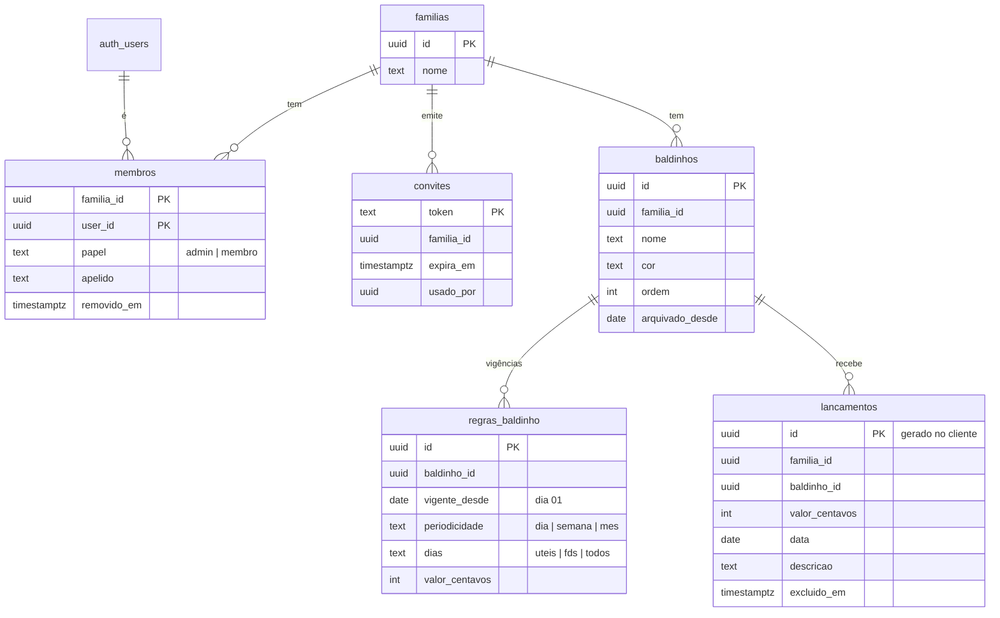

# 05 — Modelo de dados (Supabase / Postgres)

Os blocos SQL abaixo são a especificação das migrações. Copie cada bloco para o arquivo indicado em `supabase/migrations/` (prefixo com timestamp gerado por `npx supabase migration new <nome>`). Depois de aplicar, gere os tipos (`npx supabase gen types typescript --local > src/data/database.types.ts`).

## 1. Diagrama



## 2. Migração `init` — tabelas

```sql
-- ============ familias ============
create table public.familias (
  id          uuid primary key default gen_random_uuid(),
  nome        text not null check (char_length(btrim(nome)) between 1 and 60),
  criado_por  uuid references auth.users(id) on delete set null,
  criado_em   timestamptz not null default now()
);

-- ============ membros ============
create table public.membros (
  familia_id  uuid not null references public.familias(id) on delete cascade,
  user_id     uuid not null references auth.users(id) on delete cascade,
  papel       text not null default 'membro' check (papel in ('admin', 'membro')),
  apelido     text not null check (char_length(btrim(apelido)) between 1 and 30),
  entrou_em   timestamptz not null default now(),
  removido_em timestamptz,
  primary key (familia_id, user_id)
);
create index membros_user_idx on public.membros (user_id) where removido_em is null;

-- ============ convites ============
create table public.convites (
  token        text primary key default replace(gen_random_uuid()::text, '-', ''),
  familia_id   uuid not null references public.familias(id) on delete cascade,
  criado_por   uuid references auth.users(id) on delete set null,
  criado_em    timestamptz not null default now(),
  expira_em    timestamptz not null default now() + interval '7 days',
  usado_por    uuid references auth.users(id) on delete set null,
  usado_em     timestamptz,
  cancelado_em timestamptz
);
create index convites_familia_idx on public.convites (familia_id);

-- ============ baldinhos ============
create table public.baldinhos (
  id              uuid primary key default gen_random_uuid(),
  familia_id      uuid not null references public.familias(id) on delete cascade,
  nome            text not null check (char_length(btrim(nome)) between 1 and 40),
  cor             text not null check (cor ~ '^#[0-9A-Fa-f]{6}$'),
  ordem           integer not null default 0,
  arquivado_desde date check (arquivado_desde is null or extract(day from arquivado_desde) = 1),
  criado_por      uuid references auth.users(id) on delete set null,
  criado_em       timestamptz not null default now(),
  atualizado_em   timestamptz not null default now()
);
create index baldinhos_familia_idx on public.baldinhos (familia_id);

-- ============ regras_baldinho ============
create table public.regras_baldinho (
  id             uuid primary key default gen_random_uuid(),
  baldinho_id    uuid not null references public.baldinhos(id) on delete cascade,
  familia_id     uuid not null references public.familias(id) on delete cascade,
  vigente_desde  date not null check (extract(day from vigente_desde) = 1),
  periodicidade  text not null check (periodicidade in ('dia', 'semana', 'mes')),
  dias           text not null default 'todos' check (dias in ('uteis', 'fds', 'todos')),
  valor_centavos integer not null check (valor_centavos between 1 and 100000000),
  criado_por     uuid references auth.users(id) on delete set null,
  criado_em      timestamptz not null default now(),
  unique (baldinho_id, vigente_desde),
  check (periodicidade = 'dia' or dias = 'todos')
);
create index regras_familia_idx on public.regras_baldinho (familia_id);

-- ============ lancamentos ============
create table public.lancamentos (
  id             uuid primary key,                       -- gerado no cliente (ADR-06)
  familia_id     uuid not null references public.familias(id) on delete cascade,
  baldinho_id    uuid not null references public.baldinhos(id) on delete restrict,  -- RN-14
  valor_centavos integer not null check (valor_centavos between 1 and 100000000), -- RN-42
  data           date not null check (data >= date '2000-01-01'),               -- RN-41
  descricao      text not null default '' check (char_length(descricao) <= 80),
  criado_por     uuid references auth.users(id) on delete set null,
  criado_em      timestamptz not null default now(),
  atualizado_por uuid references auth.users(id) on delete set null,
  atualizado_em  timestamptz not null default now(),
  excluido_em    timestamptz                             -- ADR-05
);
create index lancamentos_familia_data_idx on public.lancamentos (familia_id, data) where excluido_em is null;
create index lancamentos_baldinho_idx on public.lancamentos (baldinho_id);
```

## 3. Migração `rls` — segurança

```sql
-- Funções auxiliares (security definer evita recursão de RLS em membros)
create or replace function public.eh_membro(f uuid)
returns boolean language sql stable security definer set search_path = public as $$
  select exists (
    select 1 from public.membros m
    where m.familia_id = f and m.user_id = auth.uid() and m.removido_em is null
  );
$$;

create or replace function public.eh_admin(f uuid)
returns boolean language sql stable security definer set search_path = public as $$
  select exists (
    select 1 from public.membros m
    where m.familia_id = f and m.user_id = auth.uid() and m.removido_em is null and m.papel = 'admin'
  );
$$;

alter table public.familias        enable row level security;
alter table public.membros         enable row level security;
alter table public.convites        enable row level security;
alter table public.baldinhos       enable row level security;
alter table public.regras_baldinho enable row level security;
alter table public.lancamentos     enable row level security;

-- familias: leitura por membros; renomear só admin; criação via função criar_familia
create policy familias_select on public.familias for select to authenticated using (public.eh_membro(id));
create policy familias_update on public.familias for update to authenticated using (public.eh_admin(id)) with check (public.eh_admin(id));

-- membros: membros veem a família toda (inclusive removidos, para exibir apelidos antigos)
create policy membros_select on public.membros for select to authenticated using (public.eh_membro(familia_id));
create policy membros_update_proprio on public.membros for update to authenticated
  using (user_id = auth.uid() and removido_em is null) with check (user_id = auth.uid());
-- só o apelido pode ser alterado diretamente
revoke update on public.membros from authenticated, anon;
grant update (apelido) on public.membros to authenticated;

-- convites: só admin lê, cria e cancela
create policy convites_select on public.convites for select to authenticated using (public.eh_admin(familia_id));
create policy convites_insert on public.convites for insert to authenticated
  with check (public.eh_admin(familia_id) and criado_por = auth.uid());
create policy convites_update on public.convites for update to authenticated
  using (public.eh_admin(familia_id)) with check (public.eh_admin(familia_id));
revoke update on public.convites from authenticated, anon;
grant update (cancelado_em) on public.convites to authenticated;

-- baldinhos e regras: qualquer membro faz tudo (delete físico barrado pela FK se houver lançamentos)
create policy baldinhos_all on public.baldinhos for all to authenticated
  using (public.eh_membro(familia_id)) with check (public.eh_membro(familia_id));
create policy regras_all on public.regras_baldinho for all to authenticated
  using (public.eh_membro(familia_id)) with check (public.eh_membro(familia_id));

-- lancamentos: qualquer membro lê, cria e altera; sem delete físico (exclusão lógica)
create policy lancamentos_select on public.lancamentos for select to authenticated using (public.eh_membro(familia_id));
create policy lancamentos_insert on public.lancamentos for insert to authenticated with check (public.eh_membro(familia_id));
create policy lancamentos_update on public.lancamentos for update to authenticated
  using (public.eh_membro(familia_id)) with check (public.eh_membro(familia_id));

-- anon não acessa nada
revoke all on public.familias, public.membros, public.convites, public.baldinhos,
              public.regras_baldinho, public.lancamentos from anon;
```

## 4. Migração `funcoes` — gatilhos e RPCs

```sql
-- ---------- Gatilhos de integridade ----------

-- baldinho do lançamento/regra precisa ser da mesma família
create or replace function public.validar_familia_do_baldinho()
returns trigger language plpgsql set search_path = public as $$
begin
  if not exists (select 1 from public.baldinhos b where b.id = new.baldinho_id and b.familia_id = new.familia_id) then
    raise exception 'O baldinho não pertence a esta família' using errcode = '23514';
  end if;
  return new;
end $$;

create trigger lancamentos_valida_familia before insert or update of baldinho_id, familia_id
  on public.lancamentos for each row execute function public.validar_familia_do_baldinho();
create trigger regras_valida_familia before insert or update of baldinho_id, familia_id
  on public.regras_baldinho for each row execute function public.validar_familia_do_baldinho();

-- autoria e carimbos de tempo dos lançamentos
create or replace function public.lancamentos_carimbos()
returns trigger language plpgsql set search_path = public as $$
begin
  -- RN-41: data não pode ser futura (tolerância de 1 dia para relógio do aparelho)
  if new.data > (now() at time zone 'America/Sao_Paulo')::date + 1 then
    raise exception 'A data não pode ser depois de hoje' using errcode = '23514';
  end if;

  if tg_op = 'INSERT' then
    new.criado_por    := auth.uid();
    new.criado_em     := now();
    new.atualizado_por := null;
    new.atualizado_em := now();
  else
    new.criado_por := old.criado_por;
    new.criado_em  := old.criado_em;
    new.familia_id := old.familia_id;
    -- exclusão é definitiva: um reenvio antigo da fila não ressuscita o lançamento
    if old.excluido_em is not null then
      return old;
    end if;
    new.atualizado_por := auth.uid();
    new.atualizado_em  := now();
  end if;
  return new;
end $$;

create trigger lancamentos_carimbos before insert or update
  on public.lancamentos for each row execute function public.lancamentos_carimbos();

create or replace function public.baldinhos_carimbos()
returns trigger language plpgsql set search_path = public as $$
begin
  if tg_op = 'INSERT' then
    new.criado_por := auth.uid();
  else
    new.criado_por := old.criado_por;
    new.familia_id := old.familia_id;
  end if;
  new.atualizado_em := now();
  return new;
end $$;

create trigger baldinhos_carimbos before insert or update
  on public.baldinhos for each row execute function public.baldinhos_carimbos();

-- ---------- RPCs ----------

-- RF-02: cria a família e torna o usuário admin
create or replace function public.criar_familia(p_nome text, p_apelido text)
returns uuid language plpgsql security definer set search_path = public as $$
declare v_id uuid;
begin
  if auth.uid() is null then raise exception 'Não autenticado' using errcode = '28000'; end if;
  insert into public.familias (nome, criado_por) values (btrim(p_nome), auth.uid()) returning id into v_id;
  insert into public.membros (familia_id, user_id, papel, apelido) values (v_id, auth.uid(), 'admin', btrim(p_apelido));
  return v_id;
end $$;

-- RF-03: informações públicas mínimas de um convite (para a tela de aceite)
create or replace function public.info_convite(p_token text)
returns table (familia_nome text, valido boolean)
language sql stable security definer set search_path = public as $$
  select f.nome,
         (c.usado_em is null and c.cancelado_em is null and c.expira_em > now())
  from public.convites c join public.familias f on f.id = c.familia_id
  where c.token = p_token;
$$;

-- RF-02/RF-03: aceita o convite (uso único)
create or replace function public.aceitar_convite(p_token text, p_apelido text)
returns uuid language plpgsql security definer set search_path = public as $$
declare v_conv public.convites%rowtype;
begin
  if auth.uid() is null then raise exception 'Não autenticado' using errcode = '28000'; end if;
  select * into v_conv from public.convites where token = p_token for update;
  if not found or v_conv.usado_em is not null or v_conv.cancelado_em is not null or v_conv.expira_em <= now() then
    raise exception 'Convite inválido' using errcode = 'P0001', hint = 'convite_invalido';
  end if;
  insert into public.membros (familia_id, user_id, papel, apelido)
    values (v_conv.familia_id, auth.uid(), 'membro', btrim(p_apelido))
  on conflict (familia_id, user_id) do update
    set removido_em = null, apelido = excluded.apelido, entrou_em = now();
  update public.convites set usado_por = auth.uid(), usado_em = now() where token = p_token;
  return v_conv.familia_id;
end $$;

-- RF-04: admin remove membro (sem remover o último admin)
create or replace function public.remover_membro(p_familia uuid, p_user uuid)
returns void language plpgsql security definer set search_path = public as $$
begin
  if not public.eh_admin(p_familia) then raise exception 'Apenas o administrador pode remover membros' using errcode = '42501'; end if;
  if exists (select 1 from public.membros where familia_id = p_familia and user_id = p_user and papel = 'admin' and removido_em is null)
     and (select count(*) from public.membros where familia_id = p_familia and papel = 'admin' and removido_em is null) <= 1 then
    raise exception 'A família precisa de pelo menos um administrador' using errcode = 'P0001', hint = 'ultimo_admin';
  end if;
  update public.membros set removido_em = now() where familia_id = p_familia and user_id = p_user;
end $$;

revoke execute on function public.criar_familia(text, text), public.info_convite(text),
  public.aceitar_convite(text, text), public.remover_membro(uuid, uuid) from anon, public;
grant execute on function public.criar_familia(text, text), public.info_convite(text),
  public.aceitar_convite(text, text), public.remover_membro(uuid, uuid) to authenticated;
```

## 5. Migração `realtime`

```sql
alter table public.baldinhos       replica identity full;  -- DELETE precisa levar familia_id para o filtro
alter table public.regras_baldinho replica identity full;
alter publication supabase_realtime add table public.lancamentos, public.baldinhos, public.regras_baldinho;
```

## 6. Consultas que o cliente faz

| Uso | Consulta (supabase-js) |
|---|---|
| Família do usuário | `from('membros').select('familia_id, papel, apelido, familias(nome)').eq('user_id', uid).is('removido_em', null)` |
| Membros (apelidos) | `from('membros').select('user_id, apelido, papel, removido_em').eq('familia_id', f)` |
| Baldinhos + regras | `from('baldinhos').select('*, regras_baldinho(*)').eq('familia_id', f).order('ordem')` |
| Lançamentos do mês | `from('lancamentos').select('*').eq('familia_id', f).gte('data', de).lte('data', ate).is('excluido_em', null)` — `de`/`ate` de `intervaloDeCarga` (RN-63) |
| Salvar lançamento | `from('lancamentos').upsert(row, { onConflict: 'id' })` |
| Excluir lançamento | `from('lancamentos').update({ excluido_em: new Date().toISOString() }).eq('id', id)` |
| Nova vigência de regra | `from('regras_baldinho').upsert(row, { onConflict: 'baldinho_id,vigente_desde' })` |
| Reordenar | um `update({ ordem })` por baldinho alterado, em sequência |
| Gastos já existem? (RN-14) | `from('lancamentos').select('id', { count: 'exact', head: true }).eq('baldinho_id', id)` |

## 7. Seed local (`supabase/seed.sql`)

Somente para desenvolvimento: criar dois usuários de teste (`membro1@teste.local`, `membro2@teste.local`) via `auth.users` local, uma família "Família Teste" com os dois como membros, os seis baldinhos e os lançamentos do vetor V1 (`docs/03` §12). Nunca rodar o seed em produção.

## 8. Testes de RLS obrigatórios

Rodar em `tests/rls/` (Vitest contra o Supabase local, autenticando como cada usuário):

1. Usuário da família A não lê nenhuma linha de `baldinhos`, `regras_baldinho`, `lancamentos`, `membros` ou `familias` da família B.
2. Usuário da família A não consegue inserir lançamento na família B nem usar um `baldinho_id` de B na própria família (a gravação é recusada, pelo gatilho `validar_familia_do_baldinho` ou pela RLS).
3. Membro comum não cria convite; admin cria.
4. Membro não altera o próprio `papel` (erro de privilégio de coluna).
5. `aceitar_convite` com token usado, expirado ou cancelado retorna `hint = 'convite_invalido'`.
6. Update de lançamento já excluído não altera a linha.
7. `delete` em baldinho com lançamentos falha (FK).
8. Usuário `anon` não lê nenhuma tabela.
